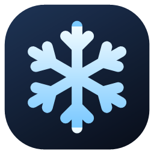
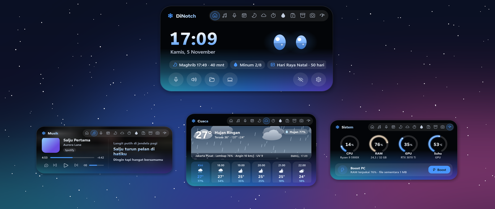

# DiNotch

**Dynamic island untuk Windows, dengan sentuhan salju ❄**

Island kecil di atas layar yang membuka saat kursor diarahkan: musik & lirik, cuaca, jadwal sholat,
notifikasi HP, kirim file ke HP, monitor PC, tangkap & rekam layar, dan maskot mata yang menemani.

[**⬇ Unduh DiNotch**](https://github.com/D1paak/DiNotch/releases/latest) · [Situs & galeri](https://d1paak.github.io/DiNotch/) · [Lisensi](LICENSE)

## Fitur

| | |
|---|---|
| 🎵 **Musik & lirik** | Spotify, YouTube Music, browser, dan pemutar lain langsung terdeteksi. Cover, kontrol, lirik sinkron yang bergulir, visualizer dari audio asli. |
| ☁ **Cuaca** | Langit hidup yang ikut cuaca: hujan dengan cipratan, petir, kabut, salju, matahari atau bulan & bintang. Suhu, peluang hujan, prakiraan 6 jam, data resmi **BMKG** per kelurahan. |
| 🕌 **Sholat** | Jadwal metode Kemenag untuk seluruh Indonesia, langit yang mengikuti matahari, adzan, pengingat. Bisa dimatikan total. |
| 🔔 **Notifikasi HP** | WhatsApp, SMS / OTP (tombol Salin), Instagram, baterai HP lemah, lewat Phone Link. Pesan panjang tampil utuh. Kartu panggilan WhatsApp dengan Terima / Tolak. |
| 📱 **Sambung HP** | Pindai QR, langsung terbuka di browser HP (satu Wi-Fi). Kirim foto & file dua arah tanpa batas ukuran, teks ke clipboard, remote musik. Tanpa install aplikasi. |
| ⚡ **Sistem & Boost** | CPU, RAM, GPU, dan suhu secara langsung. Boost melepas memori dan membersihkan file sementara. |
| 📸 **Layar** | Tangkap area, layar penuh, atau jendela. Rekam layar ke MP4 dengan suara. `Ctrl+Alt+S` · `Ctrl+Alt+R` |
| ⏰ **Waktu** | Kalender dengan hari besar Indonesia, timer / Pomodoro, stopwatch, alarm dengan 5 suara. |
| 💧 **Kesehatan** | Pengingat minum air dengan gelas beranimasi dan grafik 7 hari. |
| 🗂 **Rak & catatan** | Seret file ke island untuk disimpan sementara, seret keluar ke mana saja. Catatan cepat, riwayat clipboard. |
| 👀 **Maskot** | Mata robot, kucing, kelinci, atau beruang yang melirik, mengikuti kursor dengan gerak alami, berkedip, mengangguk mengikuti musik, dan bereaksi. Banyak aksesori. |
| 🎨 **Tampilan** | Mode Island, Notch, dan Robot. Belasan skin bergradien, warna kustom, animasi pegas yang mengikuti refresh rate monitor. |

## Unduh & pasang

1. Unduh `DiNotch.exe` dari [Releases](https://github.com/D1paak/DiNotch/releases/latest) (±4 MB).
2. Pasang [.NET 8 Desktop Runtime](https://dotnet.microsoft.com/download/dotnet/8.0) (x64) bila belum ada.
3. Jalankan `DiNotch.exe`. Tur singkat akan menjelaskan isinya. Pengaturan ada di ikon salju di tray.

Persyaratan: Windows 10 (build 19041+) atau Windows 11, 64-bit.

DiNotch bisa memeriksa versi baru sendiri (Pengaturan › Tentang).

## Ringan & privat

- ±4 MB, memori ±60 MB, hampir 0% CPU saat diam. Animasi hanya berjalan saat ada yang bergerak.
- Tanpa akun, tanpa iklan, tanpa pelacakan. File ke HP hanya lewat Wi-Fi rumahmu.
- Data dari internet hanya untuk lirik, cuaca, pencarian kota, hari libur, dan pemeriksaan pembaruan.

## Lisensi

DiNotch **gratis dipakai**, tetapi **bukan open source**. Kode sumber tidak dipublikasikan.
Dilarang menyebarkan ulang, menjual, mengubah, atau membongkar aplikasi tanpa izin. Lihat [LICENSE](LICENSE).

© 2026 Dipa. All rights reserved.
